# ApplyPilot · AI Career Automation Agent

> **Your autonomous AI career copilot for discovering, evaluating, and applying to jobs across Naukri and LinkedIn Easy Apply.**

[](LICENSE)
[](https://www.python.org/)
[](https://react.dev/)
[](https://fastapi.tiangolo.com/)
[](https://tailwindcss.com/)

---

## 💡 Why ApplyPilot?

Job searching in India often requires spending 3–4 hours every evening filling out identical screening forms on job portals. Most applications are either filtered out by automated ATS software or rejected due to experience mismatches.

- **Autonomous Application Engine:** Continuously searches, filters, and applies to relevant openings on **Naukri.com** and **LinkedIn Easy Apply**.
- **Accurate AI Screening:** Automatically answers custom recruiter questionnaires strictly using verified facts from your uploaded resume—zero hallucinations.
- **Anti-Ban Human Pacing:** Enforces natural randomized jitter delays (2.0s–5.0s) between clicks and respects strict daily quotas (50/day) to keep your accounts 100% safe.
- **Live Remote Browser:** Watch applications being completed in real-time through an interactive 15 FPS screencast, with full mouse and keyboard intervention support.
- **Real-Time Spreadsheet Sync:** Logs every applied job, salary range, company, and timestamp directly to your private Google Sheet.

---

## 🖼️ Product Overview

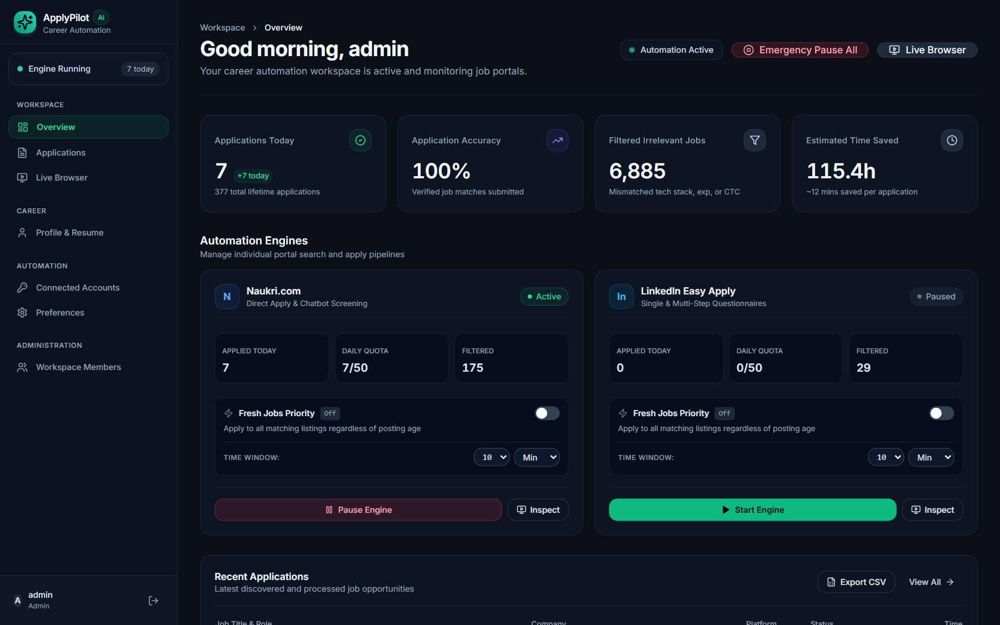

---

## ✨ Core Features

| Feature | Description |
| :--- | :--- |
| **Dual Automation Engines** | Dedicated background runners for Naukri.com direct jobs and LinkedIn Easy Apply. |
| **Dynamic Fresh Jobs Priority** | Customizable time interval filter (`5-60 min` or `1-24 hours`) targeting newly posted jobs before applicant competition spikes. Fully dynamic per-portal controls. |
| **AI Form Answering** | LLM assistant (Gemini & Groq) answers questions like "Why are you a fit?" or "Notice period?". |
| **Remote CDP Screencast** | Real-time WebSocket video stream with user-selectable framerate (`5, 10, 15, 20, 24, 30, 60 FPS`), dynamic bandwidth adaptation, and manual interaction. |
| **Application Intelligence** | Searchable audit log with clear reasons for filtered jobs (experience mismatch, excluded company). |
| **Career Profile Vault** | Stores target job titles, expected CTC, notice period, and verified PDF resumes under 5 MB. |
| **Encrypted Sessions** | Cookies are encrypted with Fernet (AES-256) and backed up to MongoDB Atlas for cold-boot recovery. |
| **Google Sheets Sync** | Real-time webhook integration automatically appends applied jobs to your personal spreadsheet. |
| **Multi-Tenant Administration** | Role-based access control (`admin` vs `user`) with tenant data isolation and user management. |

---

## ⚡ Dynamic Fresh Jobs Priority

Early applications receive over **8x higher recruiter view rates**. ApplyPilot allows configuring a dynamic freshness window for both Naukri and LinkedIn engines independently:

- **Interactive UI Selector:** Toggle on/off instantly from the dashboard. Select custom numerical intervals (`5, 10, 15, 20, 30, 45, 60` or `1, 2, 3, 4, 6, 8, 12, 24`) with duration units (`Minutes` or `Hours`).
- **Naukri Precision Radar:** Scans job cards in real time, parses relative post ages ("Just now", "5 mins ago", "1 hour ago"), and automatically skips older listings when enabled.
- **LinkedIn Search Adaptation:** Dynamically applies LinkedIn's time-posted parameters (`&f_TPR=r{seconds}`) while evaluating live card timestamps so only fresh openings are processed.
- **RESTful API Endpoint:** `POST /api/bot/{site}/fresh-filter` accepting `{"enabled": true, "threshold_minutes": 10}` with automatic fallback compatibility.

---

## 🔄 How It Works

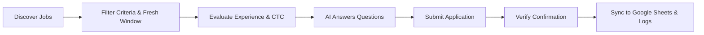

1. **Discover:** The engine searches for job cards matching your target roles and location preferences.
2. **Filter & Fresh Window:** Discards external redirects, blacklisted companies, out-of-range salaries, and jobs outside your configured dynamic freshness threshold.
3. **Evaluate:** Inspects custom screening questions (Notice Period, Total Experience, Current CTC).
4. **Answer:** The AI model drafts factual answers strictly from your profile facts and uploaded resume.
5. **Apply:** Completes multi-step application wizards with natural human clicking delays.
6. **Verify:** Validates application confirmation modals and logs the job record to MongoDB and Google Sheets.
7. **Pacing:** Pauses for 2.0–5.0 seconds before moving to the next opening.

---

## 📸 Visual Walkthrough

### 1. Public Overview & Product Tour

*High-converting product landing page detailing how the automation works, core features, and plans.*

### 2. Sign In & Authentication
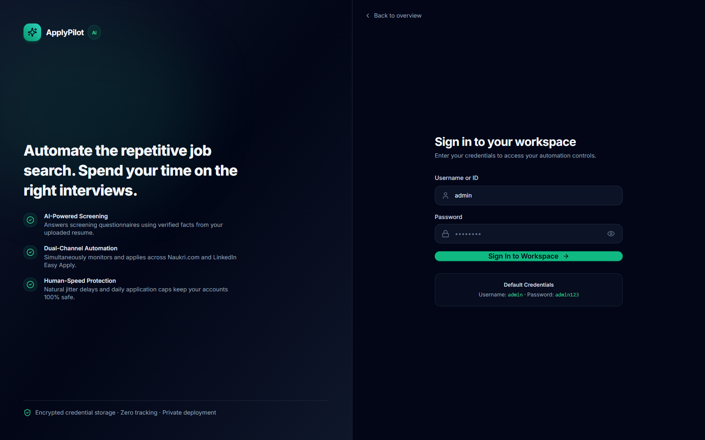
*Secure authentication interface with dual JWT and HTTP-only cookie support.*

### 3. Workspace Overview & Mission Control (HUD)

*Modern dark-first workspace with daily application quotas, status indicators, and one-click engine controls.*

### 4. Dynamic Fresh Jobs Priority & Automation Grid
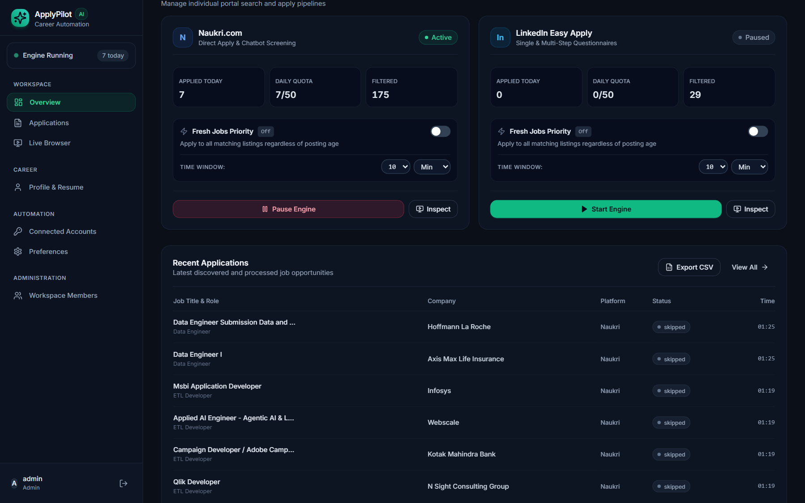
*Independent engine controls with dynamic time threshold dropdowns (`Min` / `Hour`) and real-time state badges.*

### 5. Application Operations Center
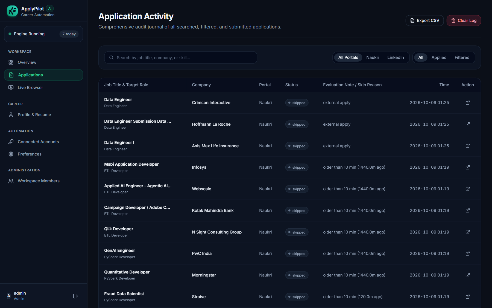
*Searchable, filterable audit log displaying all evaluated jobs, exact skip reasons, and 1-click CSV/PDF export.*

### 6. Interactive Live Remote Browser
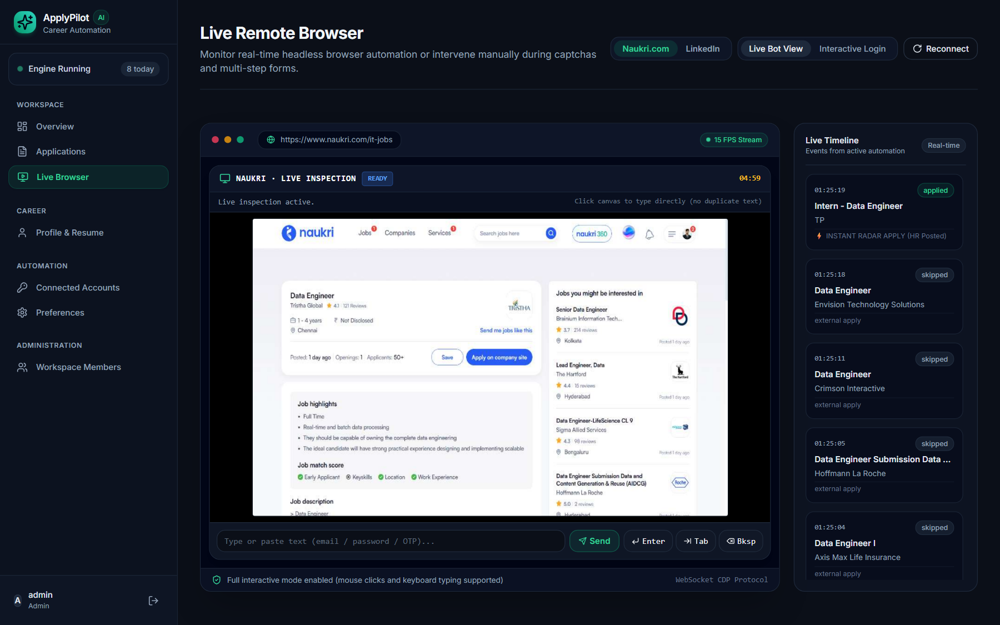
*Full-screen remote viewport powered by Chrome DevTools Protocol (CDP) WebSocket stream with manual input forwarding.*

### 7. Remote Browser Screencast Modal
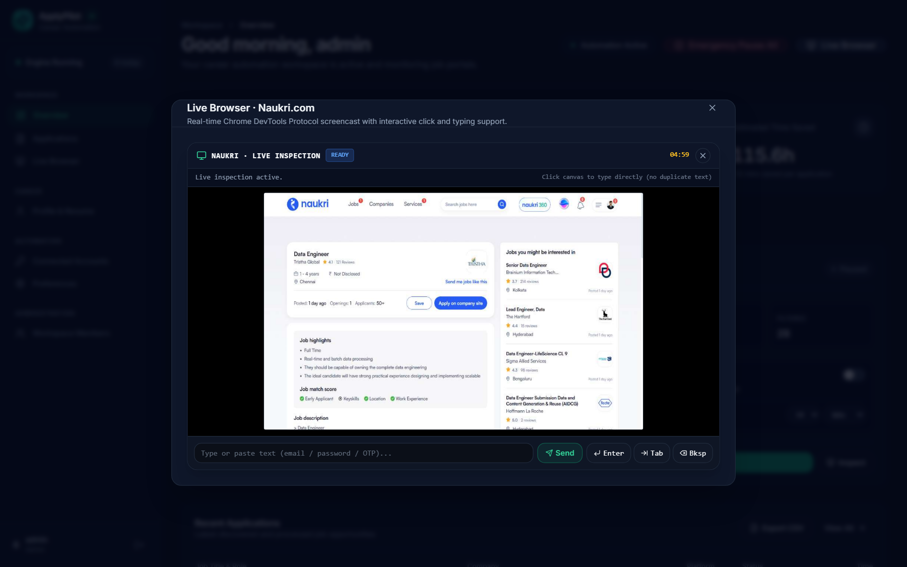
*Quick-inspection dialog to monitor live form typing or complete interactive logins.*

### 8. Career Profile & Resume Vault
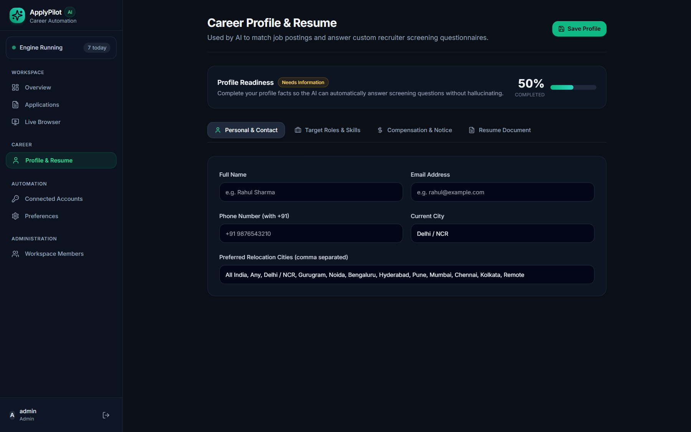
*Candidate readiness meter, preferred job roles, compensation details, and verified PDF resume storage.*

### 9. Connected Accounts & Cookie Vault
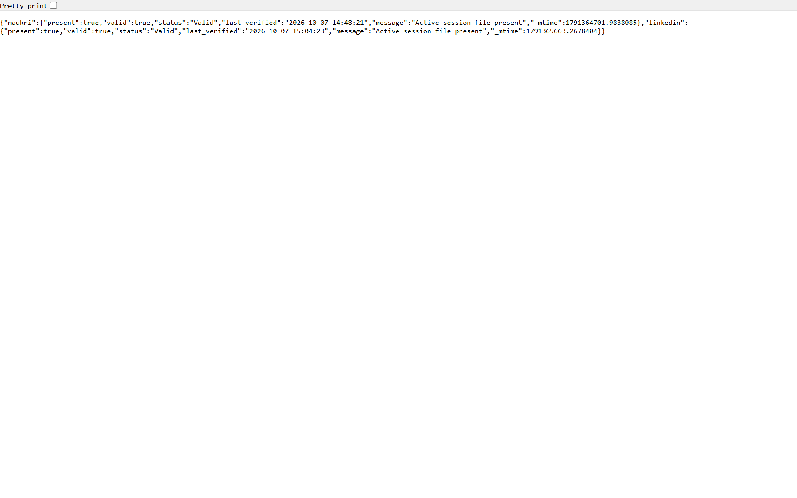
*Secure session center with Fernet encryption and residential cookie import for cloud deployment resilience.*

### 10. Workspace Preferences, Streaming & Google Sheets
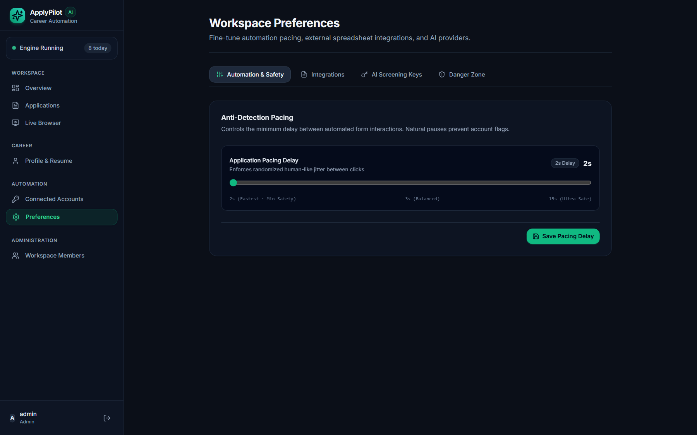
*Customizable anti-detection pacing delay (2–15s), configurable screencast framerate (5–60 FPS), Google Sheets live journal setup, and AI provider selection.*

### 11. Workspace Member Administration
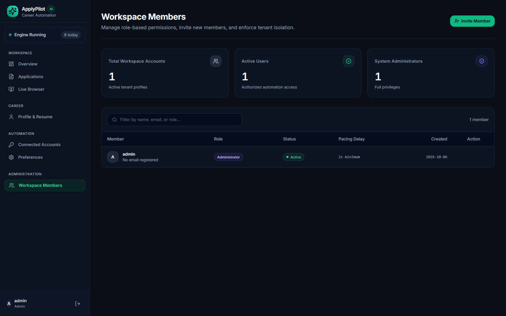
*Enterprise member management with role badges, user creation, and tenant data isolation.*

---

## 🔒 Security & Privacy Safeguards

- **Zero Plaintext Credentials:** Passwords are hashed with bcrypt (work factor 12). Session cookies are encrypted with AES-256 Fernet before database storage.
- **Tenant Isolation:** Standard users can only view and mutate their own profile, resumes, and application activity logs.
- **Safe Human Pacing:** Automation delay is strictly enforced at a minimum of 2.0 seconds with randomized micro-delays between keystrokes and button clicks.
- **Current Employer Blacklist:** Automatically skips any openings from employers you list in your profile or settings.
- **No Secret Leakage:** Production logging automatically masks tokens, passwords, and database connection strings using regex sanitizers.

---

## 🚀 Quick Start (Local Development)

### 1. Prerequisites
- **Python 3.10+** (Python 3.13 recommended)
- **Node.js 20+**
- Google Chrome or Chromium (`playwright install chromium`)

### 2. Installation & Setup

```bash
# 1. Clone repository
git clone https://github.com/your-username/applypilot.git
cd applypilot

# 2. Setup backend virtual environment
python -m venv venv
venv\Scripts\activate   # Windows
# source venv/bin/activate # Linux/macOS
pip install -r backend/requirements.txt
playwright install chromium

# 3. Compile frontend bundle
cd frontend
npm install
npm run build
cd ..

# 4. Configure environment
cp .env.example .env
```

Edit `.env` with your preferred settings:
```env
ADMIN_USERNAME=admin
ADMIN_PASSWORD=your_strong_password_here
SECRET_KEY=generate_random_32_characters_key_here
MONGODB_URI=your_mongodb_connection_string
GEMINI_API_KEY=your_gemini_api_key
```

### 3. Launch Platform

```bash
python -m uvicorn backend.app.main:app --host 127.0.0.1 --port 8000
```

- **Web Workspace:** [http://localhost:8000](http://localhost:8000)
- **API Swagger Documentation:** [http://localhost:8000/docs](http://localhost:8000/docs)
- **System Health:** [http://localhost:8000/health](http://localhost:8000/health)

---

## ☁️ Production Cloud Deployment (Render)

This repository includes a production-ready `render.yaml` blueprint.

1. Fork or push this repository to your GitHub account.
2. In the [Render Dashboard](https://dashboard.render.com), click **New +** $\rightarrow$ **Blueprint**.
3. Select this repository. Render automatically reads `render.yaml`, provisions the Docker container, installs Playwright Chromium, compiles the React assets, and starts Uvicorn.
4. Set your production environment variables (`MONGODB_URI`, `SECRET_KEY`, `ADMIN_PASSWORD`).
5. Open your live application at `https://your-service.onrender.com`.

> **Note for LinkedIn Cloud Deployments:** Because LinkedIn frequently blocks automated logins from datacenter IP addresses (AWS, GCP, Render), use the **Import Session State** feature in **Connected Accounts** to import cookies generated on your local desktop machine.

---

## 🏛️ System Architecture

```text
applypilot/
├── backend/                   # Python 3.13 / FastAPI service
│   ├── app/
│   │   ├── api/               # API routers (auth, users, profile, bot, sessions, activity, admin, sheets)
│   │   ├── core/              # Config, security (bcrypt/fernet), logging, dependencies
│   │   ├── models/            # Pydantic schemas (user, profile, bot)
│   │   ├── services/          # Automation engines, session manager, resume service
│   │   ├── db/                # MongoDB Atlas client & index management
│   │   └── main.py            # FastAPI ASGI entrypoint, middleware & SPA mount
│   ├── tests/                 # Pytest test suite (auth, rbac, isolation, pacing)
│   └── requirements.txt       # Backend dependencies
├── frontend/                  # Vite + React 18 + TypeScript + TailwindCSS
│   ├── src/
│   │   ├── components/        # UI component library, layout, screencast canvas
│   │   ├── pages/             # LandingPage, Dashboard, LiveActivity, LiveBrowserView, Sessions, MyProfile, Settings, AdminUsers, Login
│   │   ├── lib/               # API client, auth context, types, utils
│   │   ├── index.css          # Design system tokens (dark slate SaaS palette)
│   │   ├── App.tsx            # Application routes & providers
│   │   └── main.tsx           # React root entrypoint
│   └── package.json           # Frontend dependencies
├── common/                    # Core automation utilities (key rotator, engine manager, login helper, sheets)
├── data/                      # Local persistent runtime storage (sessions, cache, resumes)
├── docs/screenshots/          # High-resolution application screenshots
└── render.yaml                # Production deployment specification
```

---

## 📜 License

Distributed under the **MIT License**. See [`LICENSE`](LICENSE) for details.
